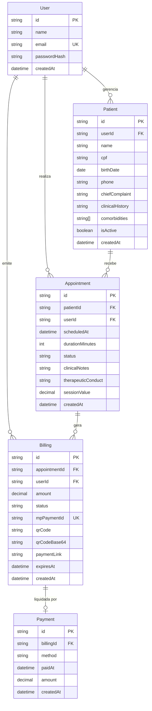

# 🛠️ Architecture / Software Design Document

**Projeto:** Auri Motion  
**Versão:** 1.4.0 · revisão da Entrega 1  
**Última atualização:** 2026-10-17  

> 🤖 **O `prd.md` responde _o quê_ o produto faz. Este responde _onde as coisas
> moram e como se chamam_.** Detalhe de tela — rota, componente, contrato —
> **não** se decide aqui: isso é trabalho da spec de cada história.

---

## 🤖 1. Fontes de Contexto para a IA

> Onde a IDE agêntica busca a verdade. **Isto é o índice; a configuração mora
> nos arquivos** — documento não configura ferramenta.

| Fonte | Onde configurar | Serve para |
| :---- | :-------------- | :--------- |
| Constituição da IA | `.agents/rules/utf-rules.md` (via `CLAUDE.md`) | Regras inegociáveis: fases do SDD, 2 rodadas, revisores distintos, Git |
| Fluxos da IA | `.agents/workflows/` | PRD, backlog, jornadas e tokens, architecture, setup, ciclo por Issue, ciclo por tarefa, tutor |
| Agentes (subagentes) | `.agents/agents/` (cascas em `.claude/`, `.cursor/` e `.opencode/`) | Implementador, revisores, auditor final e tutor |
| Ficha da disciplina | `docs/checklist.md` | Regras do projeto, IDs e entregas |
| Design (Protótipo) | https://stitch.google.com/projects/6967430572267739152 | Cores, tipografia, hierarquia visual |
| Tokens de design | `docs/design-tokens.md` | Paleta, tipografia e espaçamento que a IA deve obedecer |

---

## 📦 2. Stack Tecnológica

> Definição **estrita**: nenhuma dependência entra sem aparecer aqui. Esta
> seção e o `package.json` contam a mesma história, ou o projeto já se perdeu.
> O que a ficha da disciplina fixa entra como está; o que ela deixa livre é
> decidido na entrevista.

| Camada | Tecnologia | Versão | Página consultada | Problema que resolve |
| :----- | :--------- | :----- | :---------------- | :------------------- |
| **Backend** | NestJS (`@nestjs/core`) | 12+ | [docs.nestjs.com](https://docs.nestjs.com/) · [npmjs](https://www.npmjs.com/package/@nestjs/core) | Framework para APIs Node.js com arquitetura modular, DI e CLI oficial |
| **ORM** | Prisma ORM (`prisma`, `@prisma/client`) | 7+ | [prisma.io/docs](https://www.prisma.io/docs) · [npmjs](https://www.npmjs.com/package/prisma) | Mapeamento objeto-relacional, migrações e type-safety do PostgreSQL (linha 7+ estável; v8 em RC) |
| **Banco relacional** | PostgreSQL | 16+ | [postgresql.org/docs](https://www.postgresql.org/docs/16/) | Banco relacional com suporte completo a transações ACID |
| **Frontend** | Angular (`@angular/core`) | 22+ | [angular.dev](https://angular.dev/) · [npmjs](https://www.npmjs.com/package/@angular/core) | Framework SPA com signals reativos, standalone nativo e roteamento lazy |
| **Estilo** | Tailwind CSS (`tailwindcss`) | 4+ | [tailwindcss.com/docs](https://tailwindcss.com/docs) · [npmjs](https://www.npmjs.com/package/tailwindcss) | CSS utilitário CSS-first, configurado via `@theme` no CSS |
| **Integração Estilo (Web)** | `@tailwindcss/postcss` | 4+ | [tailwindcss.com/docs/guides/angular](https://tailwindcss.com/docs/guides/angular) · [npmjs](https://www.npmjs.com/package/@tailwindcss/postcss) | Plugin PostCSS oficial para processamento do Tailwind CSS v4 no pipeline do Angular via `.postcssrc.json` |
| **Testes (API)** | Jest (`jest`) | 30+ | [jestjs.io](https://jestjs.io/) · [npmjs](https://www.npmjs.com/package/jest) | Framework e test runner padrão gerado pelo NestJS 12 CLI para testes unitários e de integração |
| **Módulo de testes (API)** | `@nestjs/testing` | 12+ | [docs.nestjs.com/testing](https://docs.nestjs.com/fundamentals/unit-testing) · [npmjs](https://www.npmjs.com/package/@nestjs/testing) | Utilitários para criação de módulos de teste em memória e mock de providers no NestJS |
| **Compilador de testes (API)** | `ts-jest` | 29+ | [kulshekhar.github.io/ts-jest](https://kulshekhar.github.io/ts-jest/) · [npmjs](https://www.npmjs.com/package/ts-jest) | Pré-processador TypeScript para o Jest que permite executar testes sem etapa de build prévio |
| **Testes E2E (API)** | `supertest` | 7+ | [github.com/supertest](https://github.com/ladjs/supertest) · [npmjs](https://www.npmjs.com/package/supertest) | Abstração sobre requisições HTTP para teste de endpoints da API sem subir porta de rede real |
| **Lint (API)** | oxlint (`oxlint`) | 1+ | [oxc.rs/docs](https://oxc.rs/docs/guide/usage/linter.html) · [github.com/nestjs/schematics](https://github.com/nestjs/schematics) | Linter padrão oficial gerado pelo NestJS 12 CLI (`.oxlintrc.json`), executado em Rust com suporte type-aware |
| **Testes (Web)** | Vitest (`vitest`) | 5+ | [angular.dev/guide/testing](https://angular.dev/guide/testing) · [vitest.dev](https://vitest.dev/) | Suíte de testes unitários padrão e recomendada pelo Angular CLI (substitui o Karma descontinuado) |
| **Lint (Web)** | `angular-eslint` | 22+ | [angular-eslint/github](https://github.com/angular-eslint/angular-eslint) · [angular.dev/style-guide](https://angular.dev/style-guide) | Ferramenta oficial do ecossistema Angular executada pelo comando `ng lint` para análise estática de TypeScript e templates |
| **Gateway de pagamento** | Mercado Pago SDK (`mercadopago`) | 3+ | [mercadopago.com.br/pix](https://www.mercadopago.com.br/developers/pt/docs/checkout-api/integration-configuration/integrate-with-pix) · [npmjs](https://www.npmjs.com/package/mercadopago) | Emissão de pagamentos Pix via Checkout Transparente (Payments API no servidor com QR Code base64, Pix Copia e Cola, link e expiração em 5 minutos) e recepção de webhooks |
| **Job scheduler** | `@nestjs/schedule` | 12+ | [docs.nestjs.com/task-scheduling](https://docs.nestjs.com/techniques/task-scheduling) · [npmjs](https://www.npmjs.com/package/@nestjs/schedule) | Cron jobs no NestJS para expiração automática de cobranças (`@Cron`) |
| **Documentação API** | `@nestjs/swagger` | 12+ | [docs.nestjs.com/openapi](https://docs.nestjs.com/openapi/introduction) · [npmjs](https://www.npmjs.com/package/@nestjs/swagger) | Gera e serve o contrato OpenAPI/Swagger interativo a partir do código em `/docs` |
| **Config e variáveis** | `@nestjs/config` | 12+ | [docs.nestjs.com/configuration](https://docs.nestjs.com/techniques/configuration) · [npmjs](https://www.npmjs.com/package/@nestjs/config) | Carrega e valida variáveis de ambiente via `ConfigModule` |
| **Validação de env** | Joi (`joi`) | 18+ | [joi.dev/api](https://joi.dev/api/) · [npmjs](https://www.npmjs.com/package/joi) | Schema de validação das variáveis de ambiente na inicialização do `ConfigModule` |
| **Validação de entrada** | `class-validator` | 0.15+ | [github.com/class-validator](https://github.com/typestack/class-validator) · [npmjs](https://www.npmjs.com/package/class-validator) | Decoradores de validação nos DTOs (`@IsEmail`, `@IsNotEmpty`, …) |
| **Transformação de entrada** | `class-transformer` | 0.5+ | [github.com/class-transformer](https://github.com/typestack/class-transformer) · [npmjs](https://www.npmjs.com/package/class-transformer) | Converte objetos plain em instâncias de classe para o `ValidationPipe` |
| **Autenticação JWT** | `@nestjs/jwt` | 12+ | [docs.nestjs.com/security/jwt](https://docs.nestjs.com/security/authentication#jwt-functionality) · [npmjs](https://www.npmjs.com/package/@nestjs/jwt) | Emissão, assinatura e verificação criptográfica de tokens JWT |
| **Estratégia Passport** | `@nestjs/passport` | 12+ | [docs.nestjs.com/security/auth](https://docs.nestjs.com/security/authentication) · [npmjs](https://www.npmjs.com/package/@nestjs/passport) | Integração do Passport.js ao ciclo de vida e injeção do NestJS |
| **Estratégia JWT** | `passport-jwt` | 4+ | [passportjs.org/passport-jwt](http://www.passportjs.org/packages/passport-jwt/) · [npmjs](https://www.npmjs.com/package/passport-jwt) | Extrai e valida o token JWT do cabeçalho HTTP `Authorization: Bearer` |
| **Hash de senha** | `bcrypt` | 6+ | [github.com/node.bcrypt.js](https://github.com/kelektiv/node.bcrypt.js) · [npmjs](https://www.npmjs.com/package/bcrypt) | Hash seguro de senhas com salt rounds antes de persistir no banco |

### 🧩 2.1. Padrões de código — Angular 22

- **Componentes standalone** (padrão atual — não se escreve `standalone: true`).
- **Signals** para estado local (`signal()`, `computed()`, `effect()`).
- Diretivas de controle de fluxo: `@if`, `@for`, `@switch` (jamais `*ngIf` / `*ngFor`).
- **Inputs e outputs como funções:** `input()` / `output()` (jamais decoradores `@Input()` / `@Output()`).
- **Injeção de dependência via `inject()`** (jamais injeção por construtor).
- **Lazy loading por rota de feature**: cada feature é um bloco carregado sob demanda.
- **Camada de dados obrigatória:** componente jamais faz chamadas HTTP diretamente — todo acesso à API passa por um serviço de repositório dedicado (`*.service.ts` dentro da feature). Mudança de contrato mexe só nessa camada, nunca nas telas.

### 🧱 2.2. Regras estruturais do Backend — NestJS 12

Declaradas aqui para uso como critério fixo pelos revisores (IDs 6–10, 14, 17, 18, 19, 20, 21):

| ID | Padrão declarado |
| :--- | :--- |
| **ID6** | Separação estrita de camadas: `Controller` recebe a requisição e delega; `Service` contém toda a lógica de negócio; `Module` declara as dependências. Service jamais retorna entidade Prisma bruta para o controller — usa DTO de resposta. |
| **ID7** | Todo endpoint recebe e valida entrada via **DTO** decorado com `class-validator`. `ValidationPipe` global com `whitelist: true` e `forbidNonWhitelisted: true` — campos não declarados no DTO são bloqueados. |
| **ID8** | Operações relacionais executadas exclusivamente via **Prisma ORM** (`PrismaService` injetado nos services). Queries SQL brutas proibidas em código de produção. |
| **ID9** | Autenticação via **JWT** (`@nestjs/jwt` + `@nestjs/passport` + `passport-jwt`). Rotas protegidas com `JwtAuthGuard` e injeção do usuário logado via `@CurrentUser()`. Payload do token contém apenas `sub` (userId). Como o sistema opera com perfil único (fisioterapeuta autônomo), o controle de acesso e o isolamento dos dados são garantidos pelo filtro de `userId` em todas as consultas. |
| **ID10** | **Interceptor global** de resposta: envelope `{ data, meta }` para sucesso. **Exception Filter global** para erros: envelope `{ error: { code, message } }` — nenhum stack trace vaza em produção. |
| **ID14** | Swagger gerado do código via `@nestjs/swagger`, servido em `/docs`. O arquivo `swagger.json` **não é commitado** — a fonte é o endpoint vivo. Frontend deriva contratos do Swagger. |
| **ID17** | Credenciais e variáveis sensíveis (`DATABASE_URL`, `JWT_SECRET`, `MP_ACCESS_TOKEN`, etc.) **jamais aparecem no repositório**. Carregadas via `ConfigModule` com `validationSchema` (Joi) e injetadas como variáveis de ambiente na plataforma de hospedagem. |
| **ID18** | Pipeline de CI via **GitHub Actions**: roda Jest + oxlint na API e Vitest + ng lint na Web no push e no PR antes do merge na `main`. Merge bloqueado se a suite falhar. |
| **ID19** | API hospedada no **Render** (container Docker). Frontend Angular hospedado na **Vercel**. Banco PostgreSQL em produção: **Neon.tech** com Connection Pooling do Prisma (`?pgbouncer=true` na `DATABASE_URL` de produção). |
| **ID20** | Fluxo de pagamento via **Mercado Pago SDK** em sandbox: emissão de Pix via Checkout Transparente (Payments API: `payment.create` com `payment_method_id: 'pix'`) criada exclusivamente no servidor (nunca no frontend), com `date_of_expiration` de 5 minutos. O gateway retorna QR Code dinâmico (`qr_code_base64`), Pix Copia e Cola (`qr_code`), link (`ticket_url`) e o identificador `mpPaymentId`. A cobrança é persistida em `Billing` com status `PENDING`, `expiresAt` (5 minutos) e `mpPaymentId`. |
| **ID21** | Webhook de confirmação recebido no endpoint `POST /webhooks/mercadopago` (notificação de pagamento com `data.id` correspondente ao `mpPaymentId`). **Validação de assinatura** via header `x-signature` antes de qualquer alteração de estado. Consulta ao status da transação via SDK (`approved`), criação do registro em `Payment` e atualização da cobrança para `PAID`. Processamento idempotente: cobrança já `PAID` é ignorada silenciosamente (RN07 + RN08). |

### 🌐 2.3. O contrato da API

Swagger gerado do código, servido em `/docs`. O frontend deriva os contratos do Swagger — não existem tabelas de endpoints manuais neste documento. O arquivo gerado (`swagger.json`) **não é commitado**.

### ⏰ 2.4. Expiração de cobranças

Job agendado com `@nestjs/schedule` (`@Cron` a cada 1 minuto) que consulta cobranças com status `PENDING` onde `expiresAt < now()`, atualizando-as para `EXPIRED`. O tempo de expiração (`expiresAt`) é fixado em 5 minutos a partir da emissão e sincronizado com o gateway via `date_of_expiration`. A operação é idempotente: cobranças com status `PAID` são ignoradas (RN06). Resolve a dúvida aberta registrada em `docs/user-flows.md`.

---

## 🗂️ 3. Estrutura do Repositório (Monorepo)

> Uma pasta por aplicação, cada uma com o seu `package.json`. Sem npm
> workspaces, Nx ou Turborepo enquanto não houver código compartilhado de
> verdade — ferramenta sem problema para resolver é só custo.

```text
.
├── .agents/               # constituição, workflows e prompts dos agentes (§1)
├── .claude/ .cursor/ .opencode/   # cascas de cada ferramenta — só apontam para .agents/
├── .github/               # template de PR e o Portão de Entendimento
├── CLAUDE.md  AGENTS.md   # carregam a constituição em toda sessão
├── README.md              # a vitrine: o que é e como rodar
├── docker-compose.yml     # orquestração de containers locais (PostgreSQL 16)
├── docs/                  # prd.md, user-flows.md, design-tokens.md, este arquivo, checklist.md e guias
├── specs/                 # uma pasta por história implementada
└── apps/
    ├── api/               # NestJS 12 — backend, Prisma, JWT, Swagger, webhooks
    └── web/               # Angular 22 — frontend, Tailwind CSS 4, SPA
```

---

## 🏗️ 4. Arquitetura Frontend (`apps/web`)

> **Regra absoluta:** componente jamais fala com o servidor. Todo acesso à API passa por uma camada de serviço/repositório. Mudança de contrato mexe só nessa camada.

Organização interna por **feature/domínio**:

```text
apps/web/src/
├── app/
│   ├── core/                  # Serviços singleton globais (AuthService, HttpInterceptor JWT)
│   ├── shared/                # Componentes e pipes reutilizáveis sem domínio
│   └── features/
│       ├── auth/              # US01 — login e cadastro
│       ├── patients/          # US02 — carteira de pacientes
│       ├── appointments/      # US03 — agendamento e registro de atendimento
│       └── billing/           # US04 + US05 — cobranças e status de pagamento
└── styles.css                 # entrada do Tailwind CSS 4 (@import "tailwindcss" + @theme)
```

**Regras de dependência entre pastas:**
- `features/*` → pode importar de `core/` e `shared/`, nunca de outra `feature/`.
- `shared/` → não importa de `core/` nem de `features/`.
- `core/` → não importa de `features/` nem de `shared/`.

### 🧩 4.1. Cruzamento de domínios na UI: Tela Detalhe da Sessão

- A tela **Detalhe da Sessão** mora em `features/appointments`.
- Lê a cobrança pela resposta agregada do atendimento.
- Ações que mudam de contexto navegam por rota para `billing`.
- Componentes visuais sem domínio ficam em `shared`.

---

## 🏗️ 5. Arquitetura Backend (`apps/api`)

Organização interna por **módulo de domínio** (espelha as features do frontend):

```text
apps/api/src/
├── main.ts                    # bootstrap: ValidationPipe global, Swagger, Exception Filter global
├── app.module.ts
├── prisma/                    # PrismaService (singleton)
├── config/                    # ConfigModule com validação de variáveis de ambiente (Joi)
├── common/
│   ├── decorators/            # @CurrentUser()
│   ├── guards/                # JwtAuthGuard
│   ├── filters/               # GlobalExceptionFilter
│   ├── interceptors/          # ResponseInterceptor (envelope de sucesso)
│   └── pipes/                 # ValidationPipe (configurado no main.ts)
└── modules/
    ├── auth/                  # US01 — registro, login, JWT
    ├── patients/              # US02 — CRUD de pacientes + comorbidades
    ├── appointments/          # US03 — agendamentos + condutas
    ├── billing/               # US04 — emissão de cobranças
    ├── payments/              # US05 — webhook Mercado Pago, idempotência
    └── scheduler/             # job de expiração de cobranças (@nestjs/schedule)
```

**Comunicação entre domínios no Backend:**
O `AppointmentsService` lê a cobrança por consulta de leitura via Prisma (`include`), sem importar o `BillingModule`, para evitar dependência circular.

---

## 🗄️ 6. Arquitetura de Dados

### 📖 6.1. Glossário Técnico (Mapeamento)

> A ponte entre o português do negócio (PRD §2) e o inglês do código.
> **Dados e código em inglês, interface em português.**

| Termo PRD (PT-BR) | Entidade técnica (EN) | Atributos principais |
| :---------------- | :-------------------- | :------------------- |
| Fisioterapeuta | `User` | `id`, `name`, `email`, `passwordHash`, `createdAt` |
| Paciente | `Patient` | `id`, `userId` (FK), `name`, `cpf`(único por `userId`, RN12), `birthDate`, `phone`, `chiefComplaint`, `clinicalHistory`, `comorbidities` (String[]), `isActive`, `createdAt` |
| Comorbidade | _(coluna `comorbidities` em `Patient`)_ | Lista de textos armazenada diretamente no registro do paciente; sem entidade separada. |
| Atendimento (Sessão) | `Appointment` | `id`, `patientId` (FK), `userId` (FK), `scheduledAt`, `durationMinutes` (padrão 60), `status` (`SCHEDULED` \| `COMPLETED` \| `CANCELED`), `clinicalNotes`, `therapeuticConduct`, `sessionValue`, `createdAt`; conflito de horário detectado por sobreposição de `scheduledAt + durationMinutes`. |
| Cobrança (Pedido) | `Billing` | `id`, `appointmentId` (FK), `userId` (FK), `amount`, `status` (`PENDING` \| `PAID` \| `FAILED` \| `EXPIRED` \| `CANCELED`), `mpPaymentId` (UK), `qrCode`, `qrCodeBase64`, `paymentLink`, `expiresAt`, `createdAt` |
| Pagamento | `Payment` | `id`, `billingId` (FK), `method`, `paidAt`, `amount`, `createdAt` |

**Status no PRD × status no código**

| Entidade | PRD (PT-BR) | Código (EN) |
| :--- | :--- | :--- |
| `Appointment` | Agendado · Realizado · Cancelada | `SCHEDULED` · `COMPLETED` · `CANCELED` |
| `Billing` | Pendente · Pago · Falhou · Expirado · Cancelada | `PENDING` · `PAID` · `FAILED` · `EXPIRED` · `CANCELED` |

**Regras de negócio que aparecem no diagrama:** `Appointment.durationMinutes` existe por causa da RN04 (conflito de agenda); `Billing.expiresAt` por causa da RN13 (expiração em 5 minutos); `Billing.mpPaymentId` é único por causa da RN08 (processamento único); e a relação `Appointment` 1:N `Billing` existe porque uma cobrança que falha ou expira é substituída por outra da mesma sessão.

### 📊 6.2. Diagrama ER (Mermaid)



### 🌍 6.3. O banco por ambiente

| Ambiente | Onde roda | Como conecta |
| :--- | :--- | :--- |
| **Local** | PostgreSQL 16 via Docker (`docker compose up`) | `DATABASE_URL` em `.env` local (não commitado) |
| **CI** | PostgreSQL 16 via service container do GitHub Actions | `DATABASE_URL` definida pelo próprio workflow (container descartável) — não é secret |
| **Produção** | Neon.tech (PostgreSQL gerenciado) | `DATABASE_URL` com `?pgbouncer=true` injetada via variável de ambiente do Render |

> 🔒 Credenciais **nunca** aparecem no repositório — nem em código, nem em
> YAML, nem em doc. Só nos *secrets* da plataforma e no `.env` local (que está no `.gitignore`).

---

## 🗺️ 7. Mapa de Domínios

> **Este índice cresce.** Não é para preencher agora: **uma linha por história
> implementada**. Ele diz **onde mora** cada domínio e quem o protege — rota e
> contrato ficam na documentação viva da API (§2.3) e na spec de cada história,
> nunca copiados aqui.

| Domínio | Módulo (pasta) | Guard | Dados (repository) | US |
| :------ | :------------- | :---- | :----------------- | :-- |
| | | | | |

---

## 🧪 8. Como Rodar os Testes

> Declaração explícita que o `/utf-setup` exige.

### API (`apps/api`)

```bash
# Suíte de testes unitários
npm run test

# Watch mode (desenvolvimento)
npm run test:watch

# Testes de ponta a ponta (e2e)
npm run test:e2e

# Lint
npm run lint
```

### Web (`apps/web`)

```bash
# Suíte de testes
npx vitest run

# Watch mode (desenvolvimento)
npx vitest

# Lint
ng lint
```

### Comandos da raiz do monorepo

```bash
# Rodar API localmente
cd apps/api && npm run start:dev

# Rodar frontend localmente
cd apps/web && npm start

# Subir banco local
docker compose up -d
```

> ⚠️ Os comandos exatos de teste e lint na raiz do monorepo (scripts agregadores
> no `package.json` raiz) serão definidos e confirmados na **Atividade 08**, após
> o `/utf-setup` gerar os projetos.

---

## 📅 9. Histórico

| Data | Versão | O que mudou |
| :--- | :----- | :---------- |
| 2026-10-11 | 1.0.0 | Versão inicial via `/utf-architecture` |
| 2026-10-11 | 1.1.0 | Ajustes: comorbidades em Patient, durationMinutes, enums corrigidos, dependências declaradas, CI sem secret, nota Atividade 08 |
| 2026-10-12 | 1.2.0 | Linhas de versão e páginas consultadas no §2, correção de padrões CLI (Jest padrão no NestJS, oxlint confirmado, Vitest padrão no Angular), angular-eslint e @tailwindcss/postcss adicionados, docker-compose.yml no §3, tela Detalhe da Sessão isolada em appointments e justificativa de role registrada |
| 2026-10-12 | 1.3.0 | §4.1 reduzido ao princípio; leitura de billing via Prisma include no backend; remoção completa de role (User, JWT, guards, ID9); Pix via Checkout Transparente (QR Code, copia-e-cola, ticket_url, mpPaymentId); testes da API retornados ao Jest com dependências declaradas (@nestjs/testing, ts-jest, supertest) e ID18/§8 ajustados; Appointment.status mantido |
| 2026-10-17 | 1.4.0 | Revisão da Entrega 1: status CANCELED em Appointment (RN10), CPF único por fisioterapeuta (RN12), tabela de status PRD × código e regras de negócio que aparecem no ER |

---

## 🛑 O que ainda **não** está neste documento

Detalhes de funcionalidade — DTOs de endpoints específicos, máquinas de estado
de uma história — **não entram aqui**: nascem sob demanda no `spec.md` de cada
história. Este documento guarda só o que vale para o sistema inteiro.
